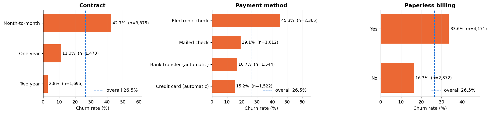
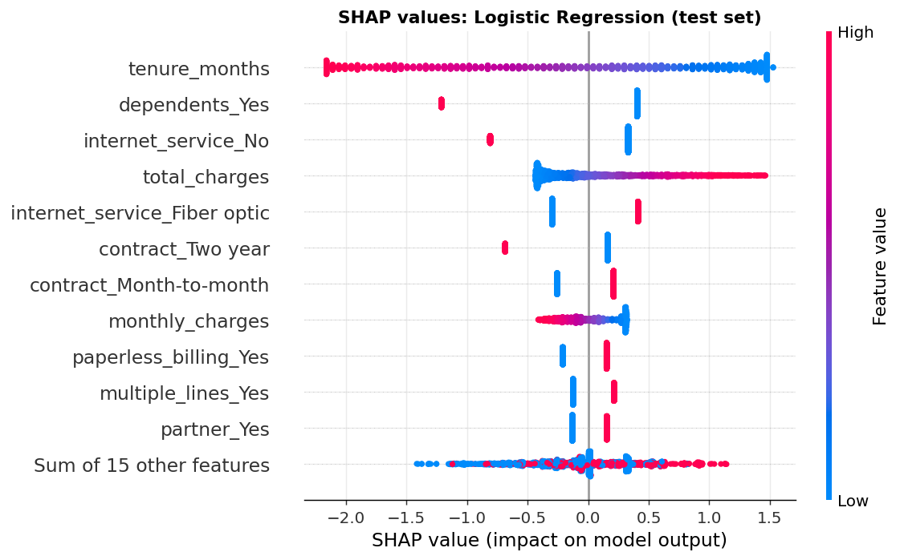
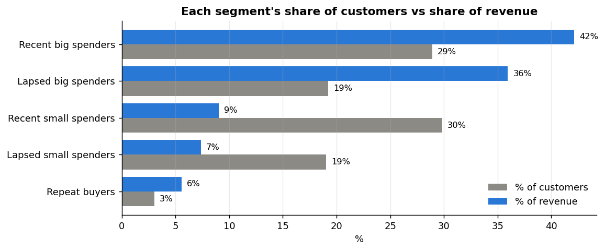

# Customer Segmentation + Churn Prediction

Two classic customer-analytics questions, answered end to end:

1. **Who are our customers?** RFM segmentation with K-Means on ~95K real Olist e-commerce customers (the PostgreSQL database from my [sales analytics project](https://github.com/viren-69/olist-sales-analytics)).
2. **Who is about to leave, why, and what should we do?** A churn model on the IBM Telco dataset (7,043 subscribers): EDA, Logistic Regression vs Random Forest, SHAP explanations, a **profit-based** decision threshold, and a [one-page business recommendation](reports/business_recommendation.md).

## Key results

| | |
|---|---|
| Churn model (test set, unseen customers) | **ROC-AUC 0.85**, 86% of churners caught at the profit-optimal threshold |
| Retention campaign value (test set, stated assumptions) | **$52.6K** model-targeted vs $44.0K at default 0.5 vs $27.5K contacting everyone |
| Robustness | Model targeting beat "contact everyone" in **27/27** assumption scenarios |
| Biggest churn driver | Month-to-month contracts: **42.7%** churn vs 2.8% on two-year contracts |
| Olist segments | "Big spender" segments = **48% of customers, 78% of revenue** |



## Three insights

**1. Contract type and the first six months decide churn.** Month-to-month customers churn at 42.7% (two-year: 2.8%), and month-to-month + fiber-optic customers at **54.6%** (2,128 people). Over half of customers in their first 6 months leave, vs 9.5% after 4 years. → *Offer discounted one-year contracts (A/B test first) and strengthen onboarding.*

**2. A strong chart isn't always a strong driver.** Electronic-check payers churn at 45%, but once contract and tenure are in the model, the payment method ranks only about 22nd. E-check payers are simply more often new, month-to-month and on fiber. → *Fix contracts and onboarding; don't expect much from pushing auto-pay alone.*

**3. The threshold is a business decision, not 0.5.** Missing a churner costs a year of revenue; an unnecessary offer costs $50. The profit-optimal cut-off is **0.21**, and it moves from 0.05 to 0.83 as the assumptions change. → *Real offer costs and customer values matter more than extra model accuracy.*



## Model comparison

| Model | CV ROC-AUC (5-fold) | Test ROC-AUC | Test recall @0.5 |
|---|---|---|---|
| Baseline (predict nobody churns) | 0.500 | 0.500 | 0% (yet **73.5% accuracy**) |
| **Logistic Regression** (chosen) | 0.859 ± 0.013 | 0.849 | 57% |
| Random Forest | 0.861 ± 0.011 | 0.855 | 53% |

Random Forest's edge is far smaller than the fold-to-fold noise, so the simpler, interpretable model was chosen. SHAP shows both models agree on the top drivers (tenure, contract, fiber, dependents).

**Leakage avoided:** the raw file contains `Churn Reason` (only filled for churners) and IBM's own `Churn Score`, which would make any model look near-perfect. Both are removed, along with `CLTV`, IDs and location columns.

## RFM segmentation (Olist)



| Segment | Customers | Revenue | Action |
|---|---|---|---|
| Recent big spenders | 29% | 42% | Second-purchase offer within 30 days |
| Lapsed big spenders | 19% | 36% | Personal win-back offer |
| Recent small spenders | 30% | 9% | Free-shipping threshold, bundles |
| Lapsed small spenders | 19% | 7% | Cheap automated emails only |
| Repeat buyers | 3% | 6% | Loyalty perks, reviews, referrals |

k = 5 was chosen over k = 4 (slightly higher silhouette) because it gives cleaner, actionable groups.

## Project structure

```
├── notebooks/
│   ├── 01_rfm_segmentation.ipynb   Olist RFM + K-Means
│   ├── 02_churn_eda.ipynb          Telco EDA and leakage check
│   └── 03_churn_model.ipynb        models, threshold, SHAP, what-if, sensitivity
├── src/                            tested logic used by the notebooks
│   ├── telco_data.py               load + clean (leakage removal)
│   ├── churn_model.py              pipelines, tuning, metrics, profit threshold, sensitivity
│   ├── explain.py                  SHAP helpers
│   ├── rfm.py                      RFM from Postgres, K-Means, segment naming
│   ├── plots.py, config.py
├── reports/
│   ├── business_recommendation.md  one-page summary for management
│   ├── model_metrics.json
│   └── figures/
├── tests/test_project.py           9 unit tests
└── GUIDE.md                        detailed walkthrough of the project
```

## Run it

```bash
python -m venv .venv && source .venv/bin/activate
pip install -r requirements.txt
cp .env.example .env     # DATABASE_URL of the Olist database (needed only for notebook 1)
```

Put `Telco_customer_churn.xlsx` (the 33-column IBM Telco customer churn dataset, available on Kaggle) in `data/raw/`. Then:

```bash
pytest
cd notebooks && jupyter nbconvert --to notebook --execute --inplace *.ipynb
```

**Stack:** Python, pandas, scikit-learn, SHAP, matplotlib, Jupyter, PostgreSQL / SQLAlchemy, pytest.
